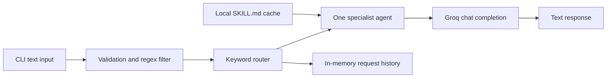

# DevMind

DevMind is a Python CLI prototype for developers who want code review, documentation drafts, or security review suggestions through one interface. A deterministic keyword router selects one of three specialist prompts, loads its local skill context, and sends one request to Groq.

The original implementation, prompts, and skill files are attributed to Ankit Singh Raghuvanshi in this repository's commit history. The project demonstrates Python application structure, HTTP integration, prompt composition, and request routing. Model suggestions require human review.

## Current implementation

- Code Analyst: requests issue explanations and proposed fixes.
- Doc Writer: requests docstrings, README drafts, and comments.
- Security Scanner: requests potential vulnerabilities and remediation suggestions.
- Local `SKILL.md` loading and caching for the selected specialist.
- A regex input filter, bounded requests, predictable provider errors, and an in-memory request log.
- A workspace-contained file helper for Python callers; the CLI does not automatically open referenced paths.

There are no autonomous tools, code execution, repository modification, retrieval, persistent conversation memory, or deployment in this implementation. The class named `MCPServer` is a local Python helper: it does not implement the Model Context Protocol transport or server API.

## Architecture



Security keywords take precedence over documentation keywords; other requests default to Code Analyst. Whole-word matching avoids routing `safe_divide` or `document_id` by substring. This rule is transparent and cheap, but ambiguous natural language and keywords inside pasted code can still select the wrong specialist.

Each call contains a specialist system prompt, skill context, and the current input. The model is `llama-3.3-70b-versatile`, with temperature `0.3`, a maximum of `1024` output tokens, and a `30` second HTTP timeout. A lower temperature does not guarantee deterministic answers. Output is free text; only the provider response envelope and non-empty content are validated.

## Install and run

Use Python 3.11 or later. Setup and offline checks were run locally with Python 3.11.15 and 3.13.0. The CI workflow targets both versions; a committed workflow alone is not evidence of a successful remote run.

```bash
git clone https://github.com/Raghuvansyn/DevMind.git
cd DevMind
python3 -m venv .venv
source .venv/bin/activate
# Windows PowerShell: .venv\Scripts\Activate.ps1
python -m pip install -r requirements.txt
python -m pip check
```

For live model responses, copy the environment template and set your own key:

```bash
cp .env.example .env
# Edit .env: GROQ_API_KEY=your_actual_key
python orchestrator.py
```

The application reads `.env` from the repository root. An existing environment variable takes precedence. A missing or placeholder key returns a configuration error before any HTTP request. No dataset, trained weights, or other model files are required. Groq access, model availability, usage limits, and billing depend on your provider account.

Try this single-line request:

```text
Review def divide(a, b): return a / b for bugs
```

It routes to `code_analyst` and sends the supplied text to Groq. Use `log` to inspect the current process's request history and `exit` to quit. Only submit source text you have permission to share with the provider; the process also retains accepted and blocked input in memory until exit.

## Reproducible offline demonstration

```bash
python -m examples.offline_demo
```

This exercises real routing, skill loading, HTTP payload construction, response formatting, and logging using **mocked provider responses**. It needs no key and makes no network requests. The fixture says that no model ran:

```text
OFFLINE DEMO: provider responses are mocked; no network or model inference.
[ORCHESTRATOR] Routing to: code_analyst
[Code Analyst]
[MOCK FIXTURE] Request and skill context received; no model ran.
```

The script also exercises Doc Writer, Security Scanner, and a blocked input. It validates the application's wiring; it does not demonstrate model review quality. The [previously recorded demo link](https://youtu.be/-DHTtXIJ8g8) is retained for context; its availability and contents were not verified during this review.

## Tests and evaluation

```bash
python -m unittest discover -v
python -m examples.offline_demo
python -m pip check
```

The suite uses Python's standard `unittest` tooling and mocks the HTTP boundary. It covers a complete routed request, skill injection, missing credentials, invalid input, blocked input, timeouts, HTTP failures, malformed provider responses, and file path containment including symlinks.

`examples/routing_cases.json` contains 12 manually authored examples covering the three routes, security precedence, and two previous substring failures. All 12 matched their expected routes in the local run; all 11 test methods passed. These are small regression checks selected to exercise the rules, not an independent benchmark or a measure of natural language routing accuracy.

The local verification used Python 3.11.15 and 3.13.0, Requests 2.34.2, and python-dotenv 1.2.4. Dependency ranges allow compatible updates and do not constitute a fully locked environment. No live model evaluation, response accuracy, latency, cost, user adoption, scalability, or deployed availability has been measured here.

## Important files

| Path | Responsibility |
| --- | --- |
| `orchestrator.py` | CLI, validation, regex filter, routing, request history |
| `agents/base_agent.py` | Prompt construction, Groq request, provider response validation |
| `agents/code_analyst.py` | Code review prompt and display prefix |
| `agents/doc_writer.py` | Documentation prompt and display prefix |
| `agents/security_scan.py` | Security review prompt and in-process scan counter |
| `skills/*/SKILL.md` | Local specialist instructions |
| `mcp/mcp_server.py` | Local skill cache and workspace-contained text reader |
| `tests/test_workflow.py` | Offline behavior and failure checks |
| `examples/offline_demo.py` | Explicitly mocked end-to-end demonstration |

## Limitations and next work

- The regex filter is a heuristic, not a sandbox or a prompt injection defense. It can reject legitimate vulnerability examples containing `eval(` or `os.system`. The application never executes generated code.
- The file helper restricts paths to a configured workspace and allowed extensions, reads at most 100,000 bytes, and rejects non-UTF-8 content. It is a local convenience API, not an isolation boundary against concurrent filesystem changes. It is not connected to model tool calls.
- A request is limited to 20,000 characters; this is a character limit, not a token budget. Large or ambiguous inputs may still fail or truncate output.
- Model suggestions can be incorrect. There is no validated structured findings schema, static analysis integration, or quality evaluation set yet.
- History is process-local and includes input, route, and basic outcome. It is not a persistent or tamper-resistant audit log. Invalid requests rejected before routing are not logged.
- Provider failures return a concise error. There are no automatic retries, streaming responses, or multi-turn context.

Useful next improvements are an explicit agent selector for ambiguous inputs, independently reviewed model quality cases with a rubric, and optional structured findings. RAG, GitHub integration, a real MCP server, and a web interface remain future work.

## Attribution and license

The repository describes the project as a [Kaggle AI Agents Intensive Capstone 2025](https://www.kaggle.com/competitions/ai-agents-intensive-capstone-2025) project; this is context, not a claim of an award or verified submission. See the [implementation notes](KAGGLE_WRITEUP.md).

Thanks to Kaggle for the program, Groq for the inference API, and Meta for Llama. The existing [MIT license](LICENSE) is unchanged.
